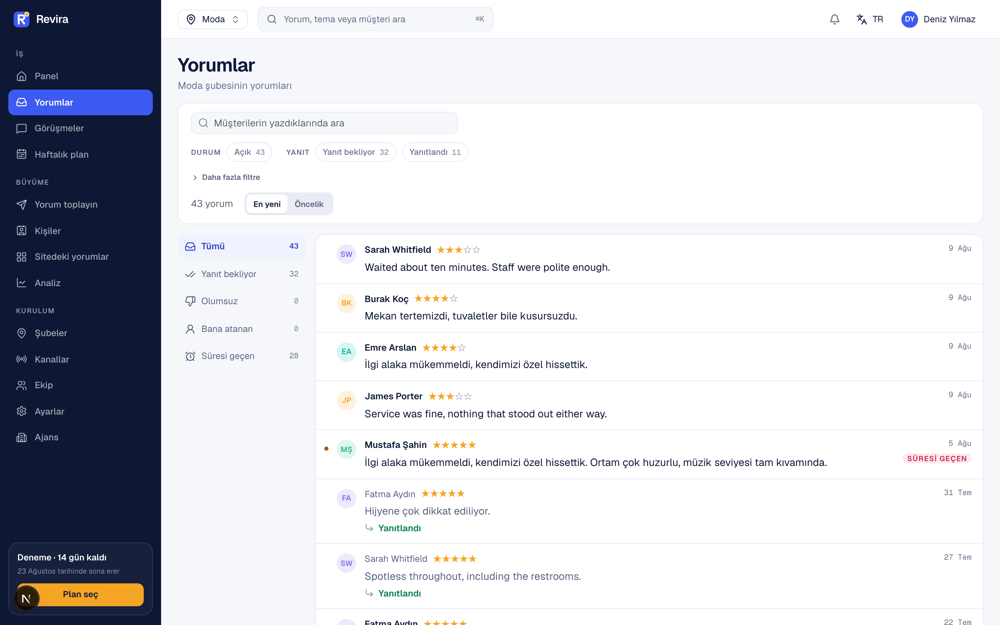

<p align="center">
  <picture>
    <source media="(prefers-color-scheme: dark)" srcset="public/brand/fairfame-lockup-on-dark.svg">
    
  </picture>
</p>

<p align="center">
  Review &amp; customer-voice management for any business in any market.<br>
  Connect your review and social sources, get told when something needs you, and get a weekly <strong>Action Digest</strong> that says what to do about it.
</p>

<p align="center">
  
</p>

---

## What it is

Businesses connect the places customers talk about them — Google, Instagram, WhatsApp, first-party collection — and Fairfame normalises all of it into one canonical `reviews` model. On top of that sit notifications, AI analysis and drafted replies, a unified triage inbox, public widgets and SEO pages, contacts, surveys and broadcasts, and the hero feature: a weekly digest of the three or four things actually worth doing.

One location or hundreds, a café or a chain. Turkish and English ship as equals — Türkiye is where the first customers are, which is why İYS consent is implemented in code, not a statement about who the product is for.

## Status

Phases 0–4 are built, plus two remediation passes. **What remains is not code.**

Three things are easy to overstate and worth stating plainly:

- **Everything runs on the mock connector.** Google, WhatsApp and Instagram are fixture- and mock-tested only. No live platform traffic has ever run through them. `pnpm mock:platform` serves a fake Google and a fake Meta over real HTTP with provider-correct error envelopes, pagination and rate limits — that proves the connectors talk to something that disagrees with them, and nothing about real quotas or OAuth consent.
- **No commercial message has ever left the machine.** `IYS_GATEWAY` and `SMS_GATEWAY` default to `none`, which refuses. Every accepted consent records how it was registered, so a local one stays distinguishable from a real one forever.
- **The re-test gate is open.** Every wave has been driven by hand in Chrome, but nobody has sat down cold in front of the build and been watched.

The remaining blockers are company-shaped, not code-shaped: a real İYS BSP, a messaging provider, live platform credentials, a competitor data source. `pnpm golive` reports per-platform readiness; it makes no writes, and "not configured" is its expected answer today.

## Quickstart

**Prerequisites:** Node ≥ 22.18, pnpm 11, Docker.

```bash
pnpm install
cp .env.example .env
```

Two variables must be filled in before anything will start:

```bash
# Auth secret
openssl rand -base64 32

# Token vault — without it, no OAuth connector and no channel connection can work.
# The failure names the variable, so you will know if you skipped it.
node -e "console.log(require('node:crypto').randomBytes(32).toString('base64'))"
```

Put the first in `BETTER_AUTH_SECRET` and the second in `TOKEN_VAULT_KEYS`. Everything else in `.env.example` has a working local default.

```bash
docker compose up -d   # Postgres 5432 · Redis 6379 · Mailpit 1025/8025
pnpm db:migrate
pnpm db:seed
pnpm dev
```

Then open <http://localhost:3000> and create an account at `/sign-up` — the seed provisions plans, a demo organization, locations and a widget, but no user; signing up is the flow you want to exercise anyway.

For background work — syncs, analysis, notifications, the digest sweep — run the worker in a second terminal:

```bash
pnpm worker
```

Outbound email goes to Mailpit; read it at <http://localhost:8025>.

## Commands

| | |
|---|---|
| `pnpm verify` | **The gate.** Lint, types, format, i18n parity, dead code, unit + DB tests, build. |
| `pnpm check` | Same without the DB tests and the build — the fast loop. |
| `pnpm test` · `test:db` · `test:e2e` | Unit · Postgres/RLS · Playwright (needs a running dev server). |
| `pnpm worker` | Background jobs. |
| `pnpm mock:platform` | A fake Google and a fake Meta over HTTP, with real error envelopes and rate limits. |
| `pnpm mock:inbound` | Signs a real Meta envelope and POSTs it at the WhatsApp webhook. |
| `pnpm mock:billing` | Drives a Stripe-shaped webhook without Stripe. |
| `pnpm email:preview` | Sends one of **every** outbound email to Mailpit, in both languages, from the real templates. |
| `pnpm golive` | Per-platform go-live readiness. Read-only. |
| `pnpm ai:smoke` · `ai:analyze` · `ai:eval` | One call · batch analysis · scored against the labelled TR/EN set. |
| `pnpm reviews:rescore` | Recompute derived triage after a change to priority or SLA rules. |

## Architecture

A **modular monolith** — one Next.js app with strong module boundaries, no microservices.

- **Next.js** (App Router) + React + **TypeScript** (strict, no `any`), Tailwind + shadcn/ui
- **PostgreSQL** with **pgvector**, self-hosted via Docker; **Drizzle** ORM, explicit SQL migrations
- **BetterAuth** (organization plugin) for auth, orgs and roles
- **Redis + BullMQ** for background jobs; **Zod** for every external input; **next-intl** (`en`, `tr`)
- **LLM** behind a provider-agnostic abstraction (stub / Gemini / Anthropic); Stripe + iyzico skeletons

Four principles do most of the load-bearing:

- **The `Connector` interface is the core abstraction** for every review and social source. Everything runs on the MockConnector by default; a real connector implements the same interface and swaps in per flag and credentials, with zero changes elsewhere.
- **Multi-tenancy is non-negotiable.** Every tenant-owned row carries `organization_id`, enforced with Postgres Row-Level Security plus a per-request tenant context. The app connects as a `NOBYPASSRLS` role, so a query that forgets its tenant returns nothing rather than everything.
- **Entitlements are a first-class primitive.** Feature access and limits come from plan config, checked server-side via `can(org, feature)` / `withinLimit(org, metric)` — never `if plan === '...'`.
- **The public surface is the hardest boundary in the product.** Widgets, badges and SEO pages serve unauthenticated to the open internet with no session to scope by. The tenant is resolved from the key in the URL and never from caller input; every read still goes through `withTenant()`; only explicitly approved reviews are returned, over an allow-listed projection. A DM can never be published, and the database refuses it.

Two compliance rules are code rather than policy: every outbound commercial message goes through `checkSendAllowed`, and a refusal is a named reason rather than a silent drop; and **no review-gating** — a public-review invitation may never be computed from a rating, a sentiment or a predicted score.

## Testing

Tests are required for tenant isolation (RLS), connector sync against fixtures, entitlement checks, AI guardrails, digest reproducibility, and per-connector contracts. Alongside those sit **completeness tests**, which are a different thing: existing suites prove a door is locked, but none of them notices a *new* door. Public routes, send paths, tenant tables and outbound senders are each enumerated from disk, and the test fails when the list grows.

## Docs

The full plan lives in [`docs/`](./docs/README.md) — 24 numbered documents, chronologically numbered rather than thematically.

Start with [`02` the PRD](./docs/02-prd.md), [`03` the technical architecture](./docs/03-technical-architecture.md) and [`06` UX, roles and flows](./docs/06-ux-roles-and-flows.md). Before touching UI, read [`15` the design system](./docs/15-design-system.md) and [`21` the visual language](./docs/21-visual-language.md); before touching the name, the logo or the marketing front door, read [`24` the brand guidelines](./docs/24-brand-guidelines.md). [`13` go-live](./docs/13-go-live.md) is what to do when credentials arrive.

[**`docs/23-build-log.md`**](./docs/23-build-log.md) is the decision record — what was built, in what order, and the argument behind each rule. Read the relevant entry before reversing a decision; there is a fair chance the alternative was tried and the entry says what went wrong.

At the repo root: `CLAUDE.md` is the project context and locked stack for Claude Code, `PRODUCT.md` the product definition. The design system has no root summary on purpose — `src/app/globals.css` holds the tokens, `docs/15` and `docs/21` the rules, and a fourth copy at the root drifted from all three before it was removed.

---

Private and unreleased. © Fairfame.
